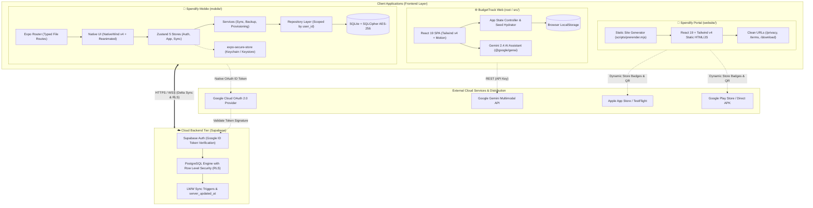
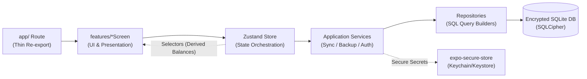
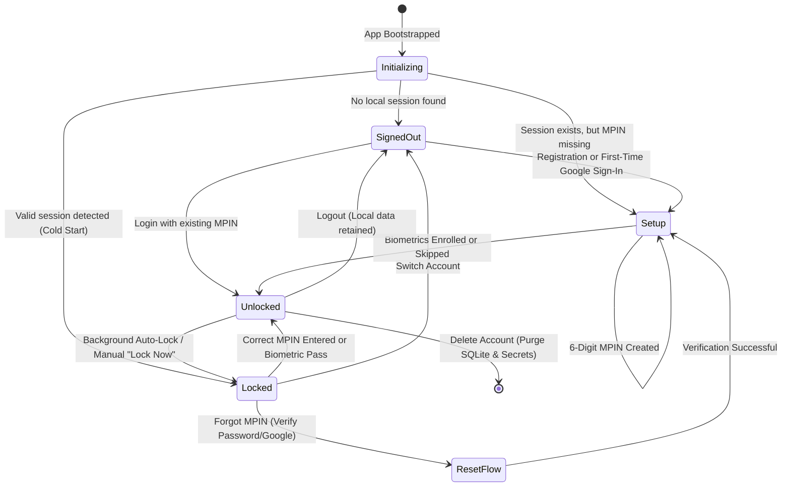
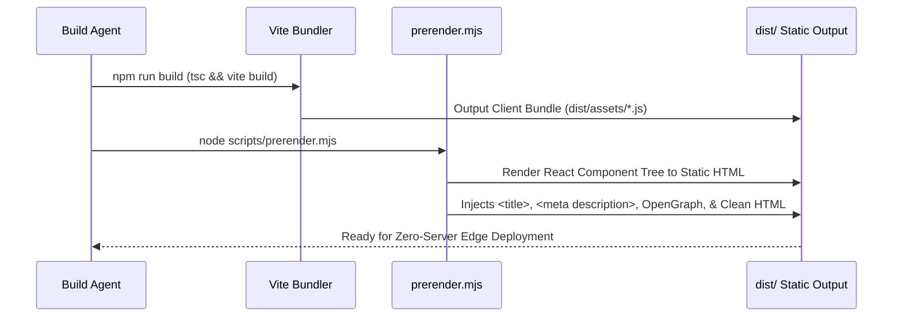
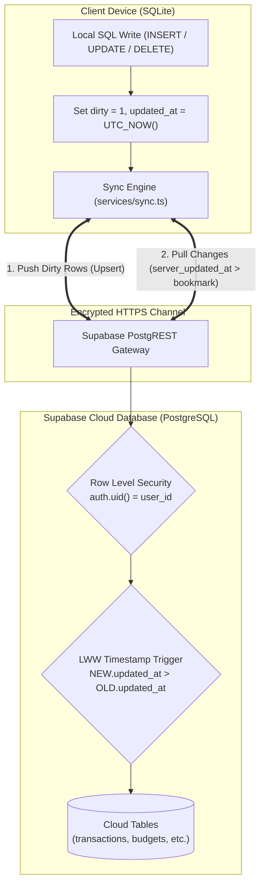
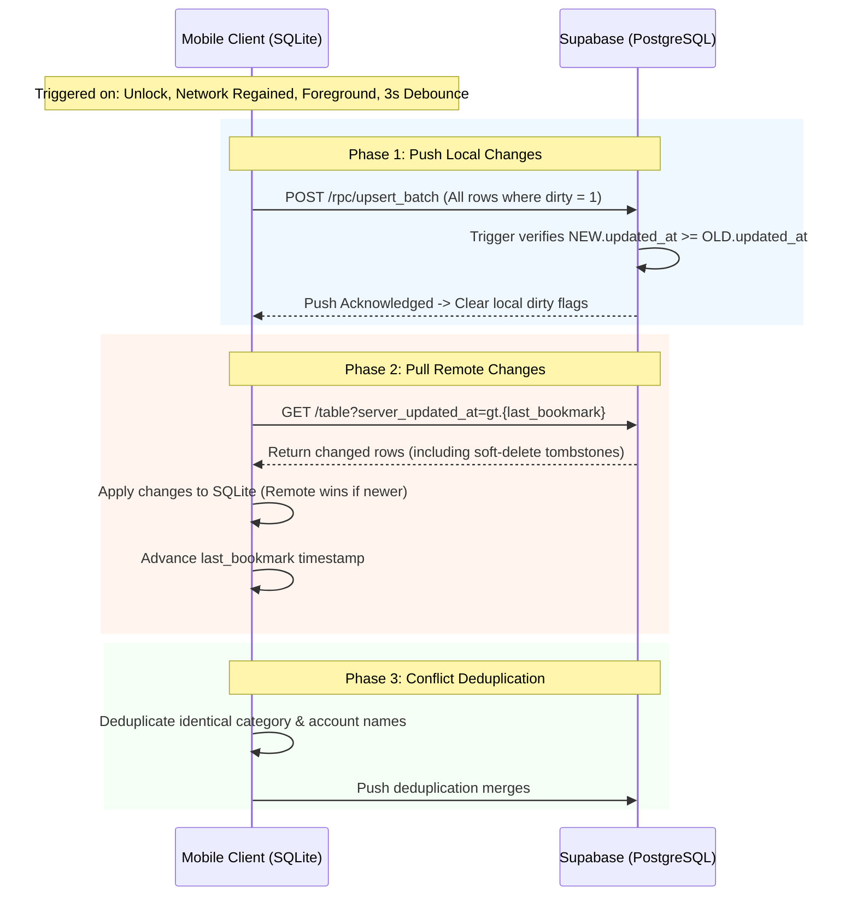
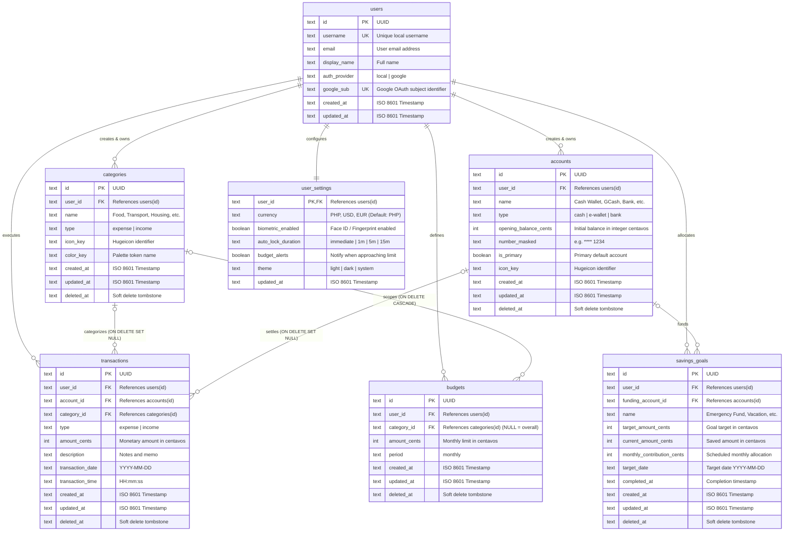
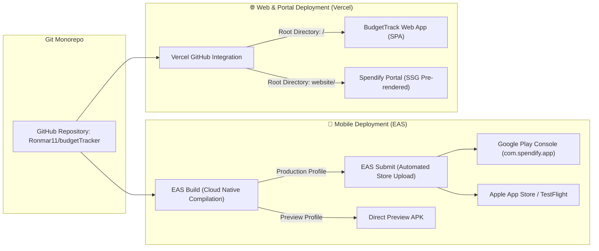
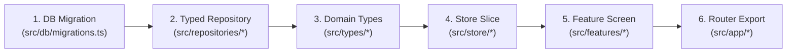

# 🏛️ BudgetTrack / Spendify — Master System Architecture & Tech Stack

> **Document Version:** 1.0.0  
> **Status:** Active / Production Baseline  
> **Ecosystem:** BudgetTrack (Web & Mobile Suite) / Spendify (Native App)  
> **Architectural Paradigm:** Offline-First, Local-Encrypted, Privacy-Preserving, Hybrid-Sync Monorepo  

---

## 📑 Table of Contents

1. [Executive Summary & Architectural Tenets](#1-executive-summary--architectural-tenets)
2. [High-Level System Topology & Ecosystem Map](#2-high-level-system-topology--ecosystem-map)
3. [Master Technology Stack Matrix](#3-master-technology-stack-matrix)
4. [Mobile Application Architecture (`mobile/`)](#4-mobile-application-architecture-mobile)
   - [4.1 Layered Clean Architecture](#41-layered-clean-architecture)
   - [4.2 Navigation & Protected State Machine](#42-navigation--protected-state-machine)
   - [4.3 Security, Keystore & Cryptographic Pipeline](#43-security-keystore--cryptographic-pipeline)
   - [4.4 Local Database Engine (SQLite + SQLCipher)](#44-local-database-engine-sqlite--sqlcipher)
   - [4.5 Reactive State Management (Zustand 5)](#45-reactive-state-management-zustand-5)
5. [Web Application Architecture (`src/` / Root)](#5-web-application-architecture-src--root)
   - [5.1 Component Topology & SPA Layout](#51-component-topology--spa-layout)
   - [5.2 Gemini AI Financial Intelligence Integration](#52-gemini-ai-financial-intelligence-integration)
   - [5.3 Web State Machine & Mockup Sandbox](#53-web-state-machine--mockup-sandbox)
6. [Landing & Distribution Website (`website/`)](#6-landing--distribution-website-website)
   - [6.1 Architecture & Static Site Generation (SSG)](#61-architecture--static-site-generation-ssg)
   - [6.2 Dynamic Distribution, QR Routing & App Store Readiness](#62-dynamic-distribution-qr-routing--app-store-readiness)
7. [Cloud Infrastructure & Synchronization Engine (`supabase/`)](#7-cloud-infrastructure--synchronization-engine-supabase)
   - [7.1 Cloud Backend Architecture & RLS Security Model](#71-cloud-backend-architecture--rls-security-model)
   - [7.2 Bidirectional Offline-First Sync Protocol](#72-bidirectional-offline-first-sync-protocol)
   - [7.3 Conflict Resolution & Entity Deduplication](#73-conflict-resolution--entity-deduplication)
8. [Data Architecture & Unified Schema Specification](#8-data-architecture--unified-schema-specification)
   - [8.1 Entity Relationship Diagram (ERD)](#81-entity-relationship-diagram-erd)
   - [8.2 Data Dictionary & Integrity Invariants](#82-data-dictionary--integrity-invariants)
   - [8.3 Financial Computation & Business Logic Rules](#83-financial-computation--business-logic-rules)
9. [Design System, UI/UX & Theming Engine](#9-design-system-uiux--theming-engine)
   - [9.1 Dynamic CSS-Variable Token Architecture](#91-dynamic-css-variable-token-architecture)
   - [9.2 NativeWind v4 & Reanimated Guidelines](#92-nativewind-v4--reanimated-guidelines)
   - [9.3 Iconography & Typography Standardization](#93-iconography--typography-standardization)
10. [DevOps, Build Pipelines & Deployment Topology](#10-devops-build-pipelines--deployment-topology)
    - [10.1 Expo Application Services (EAS) & Native Build Pipelines](#101-expo-application-services-eas--native-build-pipelines)
    - [10.2 Vercel Web Hosting & Edge Optimization](#102-vercel-web-hosting--edge-optimization)
    - [10.3 Environment Configuration & Secrets Management](#103-environment-configuration--secrets-management)
11. [Engineering Standards, Conventions & Developer Workflow](#11-engineering-standards-conventions--developer-workflow)
    - [11.1 Adding New Features (End-to-End Checklist)](#111-adding-new-features-end-to-end-checklist)
    - [11.2 Testing, Quality Assurance & Linting Protocols](#112-testing-quality-assurance--linting-protocols)
    - [11.3 Architectural Trade-Offs & Future Roadmap](#113-architectural-trade-offs--future-roadmap)

---

## 1. Executive Summary & Architectural Tenets

**BudgetTrack** (branded on mobile as **Spendify**) is a multi-tier, cross-platform personal finance management ecosystem. It provides comprehensive financial tracking—encompassing multi-account liquid cash management, categorical expenditure tracking, budget limits, automated savings targets, and multimodal AI financial insights.

```
+-------------------------------------------------------------------------------+
|                            BUDGETTRACK ECOSYSTEM                              |
+------------------------+-----------------------------+------------------------+
|   📱 Mobile Client     |       🌐 Web Client         |  🚀 Landing & Portal   |
| (Expo / React Native)  |      (React 19 / Vite)      |   (SSG / Distribution) |
|   - Offline-First DB   |   - Instant Web Dashboard   |   - App Store Links    |
|   - SQLCipher AES-256  |   - Gemini 2.4 AI Insights  |   - QR Code Routing    |
|   - Native Biometrics  |   - Responsive Frame Preview|   - Privacy / Terms    |
+------------------------+-----------------------------+------------------------+
                                       ▲
                                       │ (Optional E2EE Cloud Sync)
                                       ▼
+-------------------------------------------------------------------------------+
|                    ☁️ Supabase Cloud & PostgreSQL Engine                      |
|  - Google Identity Token Verification  - Row Level Security (RLS Isolation)   |
|  - Bidirectional LWW Delta Sync Engine - Server Timestamp Invariant Triggers  |
+-------------------------------------------------------------------------------+
```

### Core Architectural Principles

1. **Local-First & Offline Resilience:**  
   The primary source of truth is always the on-device database (`expo-sqlite` with SQLCipher on mobile, `localStorage` on web). Every write, calculation, and UI interaction executes synchronously against local storage with zero network latency.
2. **Zero-Trust Client Authentication & Data Isolation:**  
   Local authentication is strictly segregated from cloud identity. User records are encrypted at rest using device hardware keys. On the cloud layer, multi-tenant data is hermetically isolated via PostgreSQL Row Level Security (`auth.uid() = user_id`).
3. **Decoupled Layered Architecture:**  
   The presentation tier never executes raw database queries. Every data mutation flows through high-level state stores, application services, and typed repositories.
4. **Deterministic Financial Math:**  
   To prevent IEEE-754 floating-point rounding errors, all monetary amounts are stored internally as integer centavos (`amount_cents = PHP * 100`). Balances and target projections are computed as pure mathematical projections.
5. **Conflict-Free Asynchronous Cloud Sync:**  
   Sync is an optional value-add layer. Synchronization uses a last-write-wins (LWW) delta engine with soft deletes (tombstones), server-side timestamp validation, and deterministic entity deduplication.

---

## 2. High-Level System Topology & Ecosystem Map

The repository is organized as a multi-client monorepo partitioned into three core sub-applications and a cloud backend configuration.



---

## 3. Master Technology Stack Matrix

| Architectural Dimension | 📱 Mobile Client (`mobile/`) | 🌐 Web Client (`src/`) | 🚀 Landing Website (`website/`) | ☁️ Cloud & Backend (`supabase/`) |
|---|---|---|---|---|
| **Core Framework** | [React Native 0.86.3](https://reactnative.dev/) | [React 19.0.1](https://react.dev/) | [React 19.3.0](https://react.dev/) | [Supabase Managed Platform](https://supabase.com/) |
| **App Runtime / SDK** | [Expo SDK 57](https://expo.dev/) (Managed CNG) | Node.js / Modern Browser | Node.js Static Output | Cloud Native Linux / PostgREST |
| **Language & Typing** | [TypeScript 6.0](https://www.typescriptlang.org/) | [TypeScript 7.0](https://www.typescriptlang.org/) | [TypeScript 7.0](https://www.typescriptlang.org/) | PL/pgSQL / SQL-92 |
| **Build Tool & Bundler** | Metro Bundler + Babel | [Vite 8.3.0](https://vitejs.dev/) | [Vite 8.3.1](https://vitejs.dev/) + Custom SSG | Supabase CLI / Docker |
| **Routing & Navigation** | [Expo Router v57](https://docs.expo.dev/router/introduction/) (File-based) | Single Page State Router | Static HTML / Clean URLs | RESTful PostgREST endpoints |
| **Styling & Design Engine** | [NativeWind v4.2.7](https://www.nativewind.dev/) (Tailwind 3.4) | [Tailwind CSS v4.3.3](https://tailwindcss.com/) | [Tailwind CSS v4.3.3](https://tailwindcss.com/) | N/A |
| **Theming System** | CSS-Variable Dynamic Tokens (`ThemeProvider`) | CSS Custom Properties (`index.css`) | CSS Variables (Brand Palette) | N/A |
| **Iconography** | [Hugeicons Free Core](https://hugeicons.com/) (`@hugeicons/react-native`) | [Lucide React](https://lucide.dev/) (`lucide-react`) | [Hugeicons React](https://hugeicons.com/) | N/A |
| **Animation Engine** | [React Native Reanimated 4.5.1](https://docs.swmansion.com/react-native-reanimated/) | [Motion 12.23](https://motion.dev/) | Vanilla CSS Keyframes | N/A |
| **State Management** | [Zustand 5.0.15](https://github.com/pmndrs/zustand) (Modular Slices) | React State Controller (`App.tsx`) | React Component State | Realtime WAL Engine |
| **Primary Persistence** | `expo-sqlite` (SQLite with SQLCipher) | `localStorage` (Web Key-Value) | Static Assets | PostgreSQL 15+ |
| **Secure Key Storage** | `expo-secure-store` (iOS Keychain / Android Keystore) | N/A | N/A | Supabase Vault |
| **Cryptographic Engine** | `@noble/hashes` (PBKDF2-SHA256) + `expo-crypto` | Web Crypto API | N/A | `pgcrypto` |
| **Authentication** | Custom PIN/Password + Native Google Sign-In | Client Profile Switcher | N/A | Supabase Auth (JWT / GoTrue) |
| **Cloud Synchronization** | Custom Delta Engine (`services/sync.ts`) | N/A | N/A | PostgreSQL RLS + LWW Triggers |
| **File Handling & Sharing** | `expo-file-system`, `expo-sharing`, `expo-document-picker` | Native Browser Blob / Anchor | N/A | Supabase Storage (Optional) |
| **AI / Machine Learning** | N/A (Planned OCR) | [@google/genai 2.4.0](https://www.npmjs.com/package/@google/genai) (Gemini) | N/A | N/A |
| **DevOps & Hosting** | EAS Build & EAS Submit | Vercel SPA Hosting | Vercel SSG Hosting | Supabase Cloud |

---

## 4. Mobile Application Architecture (`mobile/`)

The mobile application is the primary offline-first native implementation, built using **Expo SDK 57**, **React Native 0.86**, and **NativeWind v4**.

```
mobile/src/
├── app/                  # Expo Router file-based route definitions (thin re-exports)
│   ├── (tabs)/           # Core tab bar layout: home, transactions, goals, account
│   ├── (auth)/           # Authentication gates: welcome, login, register, unlock
│   ├── _layout.tsx       # Root layout containing Stack.Protected authorization guards
│   ├── transaction/      # Modal routes for adding & editing transactions
│   └── goal/             # Modal routes for goal creation and deposit scheduling
├── auth/                 # Low-level security, crypto, PIN hashing, and session management
├── cloud/                # Supabase client singleton and native Google OAuth bridge
├── components/           # Reusable UI primitives, form controls, and layout chrome
│   ├── ui/               # Text, Button, Input, Card, Modal, Sheet, Icon
│   └── layout/           # Header, TabBar, OfflineBadge, Container
├── constants/            # Default categories, initial accounts, system constants
├── db/                   # SQLite client configuration, SQLCipher pragmas, migrations
├── features/             # Domain-driven screens and feature logic (home, account, etc.)
├── hooks/                # Custom React hooks (useOnline, useAutoLock, useTheme)
├── lib/                  # Pure math functions (finance formulas, dates, formatters)
├── repositories/         # Database access layer (scoped SQL queries per user_id)
├── services/             # Application workflows (sync engine, backup/restore, provisioning)
├── store/                # Zustand stores (authStore, appStore, preferencesStore)
├── theme/                # Color palettes, theme providers, CSS variable mappings
└── types/                # Strict TypeScript interfaces and database schemas
```

### 4.1 Layered Clean Architecture

To ensure strict separation of concerns, the mobile client enforces unidirectional data flow:



#### Architectural Invariants

1. **No SQL in UI Components:** UI screens must never import `db/client.ts` or run SQL queries. They dispatch actions via Zustand stores or application services.
2. **Strict User Scoping:** Every single query in `repositories/*` requires an explicit `user_id` parameter to guarantee zero cross-account data leakage.
3. **Pure Business Logic:** Financial calculations (`lib/finance.ts`) are pure, deterministic functions that are tested independently of React or Native runtimes.
4. **Secret Isolation:** Passwords, PIN hashes, database encryption keys, and session tokens are strictly prohibited from SQLite, AsyncStorage, JSON backups, and logs. They are stored exclusively in `expo-secure-store`.

---

### 4.2 Navigation & Protected State Machine

The mobile app implements an ironclad state machine managed by `store/auth-store.ts` and enforced by `Expo Router`'s `Stack.Protected` router gates in `src/app/_layout.tsx`.



#### Authorization Route Gates (`app/_layout.tsx`)

| Auth State | Accessible Route Groups | Blocked Route Groups |
|---|---|---|
| `signedOut` | `(auth)/welcome`, `(auth)/login`, `(auth)/register` | `(tabs)/*`, `(auth)/unlock`, `(auth)/setup-*` |
| `setup` | `(auth)/setup-pin`, `(auth)/setup-biometrics` | `(tabs)/*`, `(auth)/unlock`, `(auth)/login` |
| `locked` | `(auth)/unlock`, `(auth)/forgot-pin` | `(tabs)/*`, `(auth)/welcome`, `(auth)/setup-*` |
| `unlocked` | `(tabs)/home`, `(tabs)/transactions`, `(tabs)/goals`, `(tabs)/account`, `transaction/*`, `goal/*` | `(auth)/*` |

---

### 4.3 Security, Keystore & Cryptographic Pipeline

```
+-------------------------------------------------------------------------------+
|                       SECURITY & CRYPTOGRAPHIC STACK                          |
+-------------------------------------------------------------------------------+
| 1. Key Derivation Function (KDF):                                             |
|    - PBKDF2-HMAC-SHA256 (@noble/hashes/pbkdf2)                                |
|    - Iterations: 32,768 (2^15) | Salt: 16-Byte Cryptographic CSPRNG           |
|    - Engineered for Hermes Engine execution without UI thread blocking        |
+-------------------------------------------------------------------------------+
| 2. Hardware Keystore / Keychain (expo-secure-store):                          |
|    - Stored Keys: Database Master Key, MPIN Hash, Password Hash, Session      |
|    - Attribute: kSecAttrAccessibleAfterFirstUnlockThisDeviceOnly (iOS)         |
|    - Attribute: EncryptedSharedPreferences with Android Keystore Master Key    |
+-------------------------------------------------------------------------------+
| 3. Brute-Force & Timing Attack Mitigation:                                    |
|    - Constant-Time Byte Comparison (crypto.timingSafeEqual equivalent)        |
|    - Exponential Backoff Rate Limiter: 5 free attempts -> 30s -> Doubling     |
|    - Lockout counter unified across PIN & Password; Biometrics gated by timer |
+-------------------------------------------------------------------------------+
| 4. Database At-Rest Encryption:                                               |
|    - SQLCipher 256-bit AES-CBC full database page encryption                  |
|    - PRAGMA cipher_compatibility = 4; PRAGMA key = '<256-bit-key>'            |
+-------------------------------------------------------------------------------+
```

---

### 4.4 Local Database Engine (SQLite + SQLCipher)

Database connection is initialized via `src/db/client.ts` as a singleton.

```sql
-- Core pragmas executed on database startup
PRAGMA key = '<secure-store-master-key>';
PRAGMA foreign_keys = ON;
PRAGMA journal_mode = WAL;
PRAGMA synchronous = NORMAL;
PRAGMA busy_timeout = 5000;
```

#### Migration Lifecycle (`src/db/migrations.ts`)
Migrations use SQLite's internal `PRAGMA user_version` tracking:
- `v1`: Base relational tables (`users`, `categories`, `accounts`, `transactions`, `budgets`, `savings_goals`, `user_settings`).
- `v2`: Cloud synchronization metadata columns (`updated_at`, `deleted_at`, `dirty_flag`, `sync_state`).
- `v3`: Monthly deposit schedules and goal automation links.

---

### 4.5 Reactive State Management (Zustand 5)

State is organized into focused stores with memoized selectors to avoid unnecessary re-renders:

- `authStore`: Manages auth state machine, current user session, biometric status, and lockout timers.
- `appStore`: Manages in-memory cache of transactions, accounts, categories, goals, and budgets.
- `syncStore`: Manages network sync state, dirty entity counts, last synced timestamps, and error queues.
- `preferencesStore`: Persisted to lightweight `AsyncStorage` (Theme: Light/Dark/System, Auto-Lock Duration: Immediate/1m/5m/15m).
- `toastStore`: Ephemeral UI notifications for budget alerts, sync updates, and validation errors.

---

## 5. Web Application Architecture (`src/` / Root)

The web application is a responsive, desktop-optimized Single Page Application (SPA) with an embedded mobile device sandbox.

```
src/
├── App.tsx                     # Core Application State Controller & Tab Switcher
├── index.css                   # Tailwind CSS v4 directives & Design System Tokens
├── main.tsx                    # Web Application Bootstrap & StrictMode root
├── types.ts                    # Shared TypeScript interfaces
├── data/                       # Seed dataset (Initial categories, demo transactions)
└── components/
    ├── Header.tsx              # Application AppBar, Balance Overview, Mode Toggles
    ├── BottomNav.tsx           # Floating Mobile-Style Tab Bar Navigation
    ├── screens/
    │   ├── HomeScreen.tsx      # Balance cards, monthly cash flow, category chart
    │   ├── TransactionsScreen  # Transaction data grid, multi-filters, CSV export
    │   ├── GoalsScreen.tsx     # Savings goal cards, progress bars, contribution planners
    │   └── AccountScreen.tsx   # User profile, account linkages, security toggles
    └── modals/
        ├── AddTransactionModal # Quick transaction logging modal
        ├── AddGoalModal.tsx    # Savings target creation modal
        ├── LinkAccountModal    # Bank/E-Wallet linking modal
        └── AIInsightsModal.tsx # Gemini Multimodal AI Financial Assistant
```

### 5.1 Component Topology & SPA Layout

```mermaid
flowchart TD
    App["App.tsx (Root State Machine)"]
    
    subgraph Navigation ["Layout & Navigation"]
        Header["Header.tsx (Total Wealth, Quick Stats, Theme Toggle)"]
        BottomNav["BottomNav.tsx (Home | Transactions | Goals | Profile)"]
    end
    
    subgraph Screens ["Feature Screens"]
        Home["HomeScreen (Cash Flow, Recent Tx, Category Doughnut)"]
        Tx["TransactionsScreen (Search, Filter, Date Scope, CSV Export)"]
        Goals["GoalsScreen (Target Bars, Behind/On-Track Status, Plans)"]
        Profile["AccountScreen (Linked Wallets, Limits, Security)"]
    end
    
    subgraph Modals ["Action Overlays"]
        TxModal["AddTransactionModal.tsx"]
        GoalModal["AddGoalModal.tsx"]
        AccountModal["LinkAccountModal.tsx"]
        AIModal["AIInsightsModal.tsx (Gemini 2.4)"]
    end

    App --> Header & BottomNav
    App --> Home & Tx & Goals & Profile
    App --> TxModal & GoalModal & AccountModal & AIModal
```



---

### 5.2 Gemini AI Financial Intelligence Integration

The web app integrates Google's **Gemini 2.4 Flash** model via the official `@google/genai` SDK:

```
+-------------------------------------------------------------------------------+
|                       GEMINI AI ANALYSIS PIPELINE                             |
+-------------------------------------------------------------------------------+
| 1. Context Aggregation:                                                       |
|    Aggregates: Monthly Income vs Expenses, Category Breakdown, Goal Deficits  |
| 2. Prompt Construction:                                                       |
|    Injects financial payload into a strict financial advisor system prompt   |
| 3. Execution (@google/genai):                                                 |
|    Calls gemini-2.5-flash / gemini-2.0-flash with structured JSON response    |
| 4. UI Insight Rendering:                                                      |
|    Displays: Health Score (0-100), Anomalous Spending, Actionable Advice       |
+-------------------------------------------------------------------------------+
```

---

## 6. Landing & Distribution Website (`website/`)

The `website/` directory contains the production landing portal and app distribution gateway.

```
website/
├── index.html                  # Landing page entry point
├── privacy.html                # App Store compliant Privacy Policy
├── terms.html                  # Legal Terms of Service
├── vercel.json                 # Vercel deployment, edge caching & clean URLs
├── scripts/
│   └── prerender.mjs           # Node.js Static Pre-renderer (SSG) for SEO & Crawlers
└── src/
    ├── App.tsx                 # Main Marketing Landing Page
    ├── privacy.tsx             # Privacy Policy component
    ├── terms.tsx               # Terms of Service component
    └── components/
        ├── PhoneMockup.tsx     # Interactive App UI simulator
        ├── DownloadButtons.tsx # Smart OS-aware store buttons (iOS/Android/APK)
        └── QRCodeModal.tsx     # Desktop-to-mobile handoff QR generator
```

### 6.1 Static Site Generation (SSG) Pipeline

To guarantee search engine optimization (SEO) and satisfy strict app store crawler requirements (such as Google OAuth Brand Verification), the build script executes `scripts/prerender.mjs` post-compilation:



---

### 6.2 Dynamic Distribution & OS Routing

The distribution layer dynamically detects the user's User-Agent and renders contextual call-to-actions:

```
User visits website/
  ├── iOS Device (Safari / Chrome iOS) -> Prioritizes "Download on App Store" / "TestFlight Beta"
  ├── Android Device (Chrome / Samsung) -> Prioritizes "Get it on Google Play" / "Download APK"
  └── Desktop Browser (macOS / Windows) -> Displays Dual Badges + Desktop QR Code for instant mobile scan
```

---

## 7. Cloud Infrastructure & Synchronization Engine (`supabase/`)

The cloud infrastructure is built on **Supabase (PostgreSQL 15+)** to provide optional end-to-end multi-device synchronization and Google OAuth verification.



### 7.1 Cloud Backend Architecture & RLS Security Model

Every cloud table enforces PostgreSQL **Row Level Security (RLS)**. The public `anon` role is strictly sandboxed.

```sql
-- Example RLS Policy applied to all synced tables
ALTER TABLE public.transactions ENABLE ROW LEVEL SECURITY;

CREATE POLICY "Users can only read own transactions"
ON public.transactions FOR SELECT
USING (auth.uid() = user_id);

CREATE POLICY "Users can only modify own transactions"
ON public.transactions FOR ALL
USING (auth.uid() = user_id)
WITH CHECK (auth.uid() = user_id);
```

---

### 7.2 Bidirectional Offline-First Sync Protocol

The sync engine (`services/sync.ts`) executes a 3-phase synchronization protocol:



---

### 7.3 Conflict Resolution & Entity Deduplication

1. **Client UUID Generation:** All entities are created locally with random UUIDs (`v4`), preventing primary key collisions when inserting offline across multiple devices.
2. **Soft Deletes (Tombstones):** Deleted records are flagged with `deleted_at = NOW()`. Queries filter `deleted_at IS NULL`, allowing deletions to propagate cleanly during cloud pull operations.
3. **Deterministic Deduplication:** If two devices initialize offline with default accounts (e.g., "Cash Wallet"), the sync engine automatically merges them by retaining the oldest record (`MIN(created_at, id)`) and repointing all related foreign key transactions.

---

## 8. Data Architecture & Unified Schema Specification

### 8.1 Entity Relationship Diagram (ERD)



---

### 8.2 Data Dictionary & Integrity Invariants

1. **Integer Centavos Standard:**  
   Every monetary amount (`amount_cents`, `opening_balance_cents`, `target_amount_cents`) is stored as an integer representing centavos (1 PHP = 100 Centavos). Calculations use integer arithmetic:
   $$\text{Display Amount} = \frac{\text{amount\_cents}}{100}$$
2. **Derived Dynamic Account Balances:**  
   To prevent account balance discrepancies, account balances are dynamically computed in SQL:
   $$\text{Balance} = \text{opening\_balance\_cents} + \sum \text{Income} - \sum \text{Expense}$$
3. **Linear Savings Goal Trajectory:**  
   A goal's status is dynamically evaluated as:
   - **Completed:** $\text{current\_amount\_cents} \ge \text{target\_amount\_cents}$ or $\text{completed\_at} \ne \text{NULL}$
   - **Behind:** $\text{current\_amount} < (\text{Target} \times \text{Elapsed Progress Time}) \times 0.95$ (5% grace threshold)
   - **On Track:** Meeting or exceeding the straight-line linear savings curve.

---

## 9. Design System, UI/UX & Theming Engine

The ecosystem shares a cohesive design language characterized by dark/light duality, glassmorphism, fluid micro-interactions, and accessible typography.

### 9.1 Dynamic CSS-Variable Token Architecture

```
Design System Tokens (RGB Triplet Variables)
├── --color-background       # Base surface canvas
├── --color-surface          # Elevated card and container background
├── --color-surface-variant  # Secondary input and chip background
├── --color-primary          # Brand Emerald / Mint Accent
├── --color-on-primary       # High-contrast text on primary
├── --color-text-primary     # High-contrast heading typography
├── --color-text-secondary   # Medium-contrast body typography
├── --color-text-muted       # Low-contrast captions and placeholders
├── --color-danger           # Expense / Error Red
├── --color-success          # Income / Goal Green
└── --color-border           # Hairline border and divider tone
```

#### Multi-Platform Theming Implementation

- **Web & Website:** Managed via Tailwind CSS v4 CSS variables defined in `index.css` and toggled via the `dark` class on `document.documentElement`.
- **Mobile Client:** Managed via `theme/palette.js`, injected dynamically into the React Native root hierarchy using NativeWind's `vars()` utility inside `theme/ThemeProvider.tsx`.

---

### 9.2 NativeWind v4 & Reanimated Guidelines

> [!WARNING]
> **NativeWind + Reanimated Nesting Rule:**  
> Never attach a Tailwind `className` and a Reanimated `useAnimatedStyle` to the exact same React Native component. On native platforms, NativeWind may drop className styles. Always wrap the element in an outer `Animated.View` for animation styles and place classes on an inner plain `View`.

```tsx
// Correct Pattern
<Animated.View style={animatedStyle}>
  <View className="h-4 w-4 rounded-full bg-primary" />
</Animated.View>
```

---

### 9.3 Iconography & Typography Standardization

- **Typography:** [Inter Variable](https://rsms.me/inter/) font family across all platforms. On Android, `components/ui/Text` automatically maps font weights (`font-bold`, `font-semibold`) to Inter Android font definitions.
- **Mobile Icons:** [Hugeicons Free Core](https://hugeicons.com/) (`@hugeicons/react-native`) tree-shaken by component name in `components/ui/icon/icons.ts`. Category icon mappings store immutable icon keys in SQLite.
- **Web Icons:** [Lucide React](https://lucide.dev/) (`lucide-react`) dynamic icon registry.

---

## 10. DevOps, Build Pipelines & Deployment Topology



### 10.1 Expo Application Services (EAS) & Native Build Pipelines

Configuration is centralized in `mobile/eas.json`:

```json
{
  "cli": { "version": ">= 15.0.0" },
  "build": {
    "development": {
      "developmentClient": true,
      "distribution": "internal"
    },
    "preview": {
      "distribution": "internal",
      "android": { "buildType": "apk" }
    },
    "production": {
      "autoIncrement": true
    }
  },
  "submit": {
    "production": {
      "android": { "track": "internal" },
      "ios": {}
    }
  }
}
```

---

### 10.2 Vercel Web Hosting & Edge Optimization

The landing website (`website/vercel.json`) is optimized for zero-latency static delivery:

- **Clean URLs:** Routes `/privacy` and `/terms` resolve without trailing `.html`.
- **Cache Invalidation:** Immutable caching (`Cache-Control: public, max-age=31536000, immutable`) for hashed assets in `dist/assets/*`.
- **Security Headers:** Strict Content Security Policy (CSP), `X-Content-Type-Options: nosniff`, and `Referrer-Policy: strict-origin-when-cross-origin`.

---

### 10.3 Environment Configuration & Secrets Management

```
+-------------------------------------------------------------------------------+
|                       ENVIRONMENT VARIABLE MATRIX                             |
+-------------------------------------------------------------------------------+
| Variable Name                   | Scope        | Description                  |
+---------------------------------+--------------+------------------------------+
| EXPO_PUBLIC_SUPABASE_URL        | Mobile App   | Cloud Supabase Project URL   |
| EXPO_PUBLIC_SUPABASE_ANON_KEY   | Mobile App   | Public Anon JWT Token        |
| EXPO_PUBLIC_GOOGLE_WEB_CLIENT_ID| Mobile App   | Google OAuth Web Client ID   |
| EXPO_PUBLIC_GOOGLE_IOS_CLIENT_ID| Mobile App   | Google OAuth iOS Client ID   |
| GEMINI_API_KEY                  | Web Client   | Google AI Studio API Key     |
| VITE_IOS_APP_STORE_URL          | Website      | Production iOS Listing URL   |
| VITE_ANDROID_PLAY_STORE_URL     | Website      | Production Play Store URL    |
| VITE_ANDROID_APK_URL            | Website      | Direct Download APK URL      |
| VITE_CONTACT_EMAIL              | Website      | Official Legal Contact Email |
+-------------------------------------------------------------------------------+
```

---

## 11. Engineering Standards, Conventions & Developer Workflow

### 11.1 Adding New Features (End-to-End Checklist)

When introducing a new domain feature or data entity, follow this strict 6-stage lifecycle:



1. **Database Migration:** If adding a table or column, append to `MIGRATIONS` in `src/db/migrations.ts` and `supabase/migrations/`. Never modify shipped migrations.
2. **Repository Layer:** Create or update repository functions in `src/repositories/`. Ensure all queries are scoped by `user_id` and sanitize user inputs.
3. **Domain Types:** Define TypeScript interfaces in `src/types/`.
4. **Zustand Store:** Add state variables, actions, and memoized selectors in `src/store/`.
5. **Feature Screen:** Implement UI components in `src/features/<feature>/` using design system primitives (`Text`, `Button`, `Card`, `Icon`).
6. **Router Entry:** Export a clean one-line route in `src/app/` and register within the appropriate `Stack.Protected` gate in `src/app/_layout.tsx`.

---

### 11.2 Testing, Quality Assurance & Linting Protocols

Before committing changes or building release binaries, execute the verification suite:

```bash
# Mobile Workspace Verification
cd mobile
npm run typecheck         # Validates TypeScript types across all files
npm run lint              # Executes ESLint 9 rules with Expo config
npx expo-doctor           # Audits native dependency versions and plugin configs

# Web Workspace Verification
cd ..
npm run lint              # TypeScript typechecking
npm run build             # Validates Vite production bundle compilation

# Website Verification
cd website
npm run typecheck         # TypeScript typecheck
npm run build             # Verifies static build & prerender.mjs SSG output
```

---

### 11.3 Architectural Trade-Offs & Future Roadmap

```
+-------------------------------------------------------------------------------+
|                       ARCHITECTURAL TRADE-OFFS MATRIX                         |
+-----------------------------------+-------------------------------------------+
| Design Choice                     | Rationale & Engineering Trade-Off         |
+-----------------------------------+-------------------------------------------+
| PBKDF2 @ 32,768 Iterations        | Trade-off between KDF strength and unlock |
|                                   | latency on low-end devices without Hermes |
|                                   | JIT. Protected by SecureStore hardware.   |
| Last-Write-Wins (LWW) Row Sync    | Row-level clock resolution provides low   |
|                                   | complexity and high offline availability  |
|                                   | without requiring CRDT memory overhead.   |
| Pure Integer Centavos Math        | Eliminates IEEE-754 floating point errors |
|                                   | at the cost of explicit integer scaling.  |
| Derived Account Balances          | Guaranteed consistency between ledger and |
|                                   | accounts at the cost of SQL aggregation.  |
+-----------------------------------+-------------------------------------------+
```

#### Future Architectural Roadmap

- [ ] **Multi-Currency Real-Time Exchange Engine:** Support for dynamic exchange rate feeds and multi-currency wallets.
- [ ] **On-Device Receipt OCR Scanner:** Integration of lightweight on-device vision models for instant receipt parsing.
- [ ] **End-to-End Encrypted Cloud Backups:** Zero-knowledge client-side encryption of all Supabase rows using device-derived passkeys.
- [ ] **Automated Bank Feed Integrations:** Open Banking API connectors for automated transaction importing.
- [ ] **Interactive PDF & Financial Statement Exporter:** Client-side vector PDF generation for tax and budget reporting.

---

<div align="center">

**BudgetTrack / Spendify Architecture Documentation**  
*Maintained by the Engineering Team — Apache-2.0 License*

</div>
